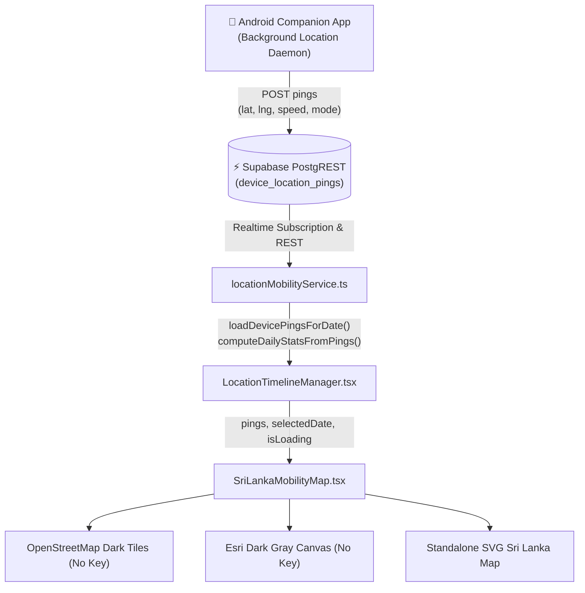

# Apex LifeOS - New Features & Updates Documentation

This document provides a comprehensive guide to the latest features, architecture enhancements, and telemetry updates in **Apex LifeOS**.

---

## 🌟 Highlights of Recent Updates

### 1. 🇱🇰 Sri Lanka GPS Mobility & Route Explorer Map
A dedicated, high-contrast dark-mode geospatial tracking map component (`SriLankaMobilityMap.tsx`) designed for visualizing location breadcrumbs and travel routes:

* **Zero-Key Multi-Engine Rendering**:
  * **🌙 Dark Mode OpenStreetMap (Default)**: Leverages standard, public, community-maintained OpenStreetMap tiles with a custom CSS dark-inversion filter (`.dark-map-tiles`). Provides full street-level zoom (up to level 19) across Sri Lanka with **zero API keys and zero watermarks**.
  * **🗺️ Esri Dark Gray Canvas**: High-contrast dark gray base from ArcGIS Online (`server.arcgisonline.com`) with clean geographical boundaries and labels (no API key required).
  * **☀️ Standard OpenStreetMap**: Daylight full-color OpenStreetMap basemap.
  * **🇱🇰 Zero-Dependency SVG Vector Fallback**: Integrated mathematical Mercator projection mapping Sri Lanka's island outline (`5.85°N - 9.95°N`, `79.50°E - 81.95°E`) and landmark hubs (Colombo, Kandy, Galle, Jaffna, Negombo, Kalutara, Anuradhapura, Trincomalee, Batticaloa, Matara).
* **Color-Coded Transport Modes**:
  * 🚗 **Motorized Vehicle / Transit**: Blue / Indigo (`#3b82f6`)
  * 🚶 **Pedestrian Walking**: Emerald Green (`#10b981`)
  * 🚲 **Cycling**: Cyan (`#06b6d4`)
  * 🚅 **High-Speed Transit**: Purple (`#a855f7`)
* **Waypoint & Dwell Stop Intelligence**:
  * 🟢 **Departure Point**: Pulsing green dot with departure timestamp.
  * 🏁 **Final Destination**: Checkered flag badge with arrival timestamp.
  * 🛑 **Dwell Stop Sentinel**: Detects and highlights stationary clusters staying within $\approx 50\text{m}$ for $\ge 4\text{ minutes}$.
* **Interactive Timeline Scrubber & Journey Playback**:
  * Step-by-step slider scrubbing through every recorded coordinate ping.
  * Play/Pause animation with adjustable playback multipliers (**1x**, **2x**, **5x**).
  * **Floating Telemetry HUD**: Displays real-time speed ($\text{km/h}$), battery level %, charging status, coordinates, and timestamp.
* **1-Click View Actions**:
  * **Fit Route**: Zooms and pans to frame the entire day's recorded journey.
  * **🇱🇰 Sri Lanka Island View**: Instantly resets camera to view the entire island of Sri Lanka.
  * **Basemap Switcher**: Seamlessly toggle between 🌙 Dark, 🗺️ Esri, ☀️ Street, and 🇱🇰 Vector modes.

---

### 2. 📅 Historical Travel Inquiry & Date-by-Date Tracking
Users can now inspect their travel logs across past calendar dates in the **Daily Commute & Movement Summary** section:

* **Interactive Date Navigator**:
  * Jump between days with **Previous Day** (`<`) and **Next Day** (`>`) buttons.
  * Native calendar date picker (`<input type="date" />`) bounded to available recorded dates.
  * Quick **"Today"** button to jump directly back to current live telemetry.
* **On-the-Fly Statistical Synthesis**:
  * When aggregated database summaries (`daily_mobility_stats`) have not yet been pre-calculated or display zero, the client dynamically evaluates raw sequential breadcrumbs from `device_location_pings` using the geodesic Haversine formula (`computeDailyStatsFromPings`).
  * Calculates total distance, active transit time, walking vs. cycling vs. vehicle modal splits, top speed, and estimated commute fuel/fare cost (${\approx}\text{Rs } 75/\text{km}$ vehicle rate).

---

### 3. 📱 Android Companion APK Telemetry Fixes
Recent companion app improvements ensure reliable ping delivery:

* **Clean Supabase PostgREST Sync**: Resolved `resolution=ignore-duplicates` HTTP 400 Bad Request error by removing redundant conflict headers on standard inserts.
* **Offline Room Cache**: Automatic queueing and background flushing when network connectivity transitions from offline to online.
* **Zero-Drift Kinetic Gating**: Accelerometer and step detector filtering ensure GPS jitter and desk wandering do not register false movement.

---

---

### 4. 🚀 Automated Android Companion APK Auto-Release & CI/CD Pipeline
Apex LifeOS now features fully automated continuous delivery for the native Android companion APK:

* **Automatic Release Publishing After Every Build**:
  * Pushing changes to `android-companion/**` or triggering manual runs in GitHub Actions automatically builds both Debug and Release APKs and creates a GitHub Release.
  * Eliminates manual release drafting, manual tagging hurdles, and release collision errors.
* **Dynamic Run-Number Semantic Versioning**:
  * Resolves version tags dynamically as `v1.0.<run_number>` (or uses custom tag when triggered by a Git tag).
  * Injects `versionCode` and `versionName` into Gradle at compile-time (`-PversionCode=${run_number}`, `-PversionName=1.0.${run_number}`).
  * Enables seamless in-place APK updates on Android devices without requiring uninstallation.
* **Direct Sideload Downloads & Permalinks**:
  * Releases are tagged with `make_latest: true`, maintaining persistent download permalinks:
    * **Latest Release**: `https://github.com/layanmoyura/ai-finance-tracker/releases/latest`
    * **Direct Sideload Debug APK**: `https://github.com/layanmoyura/ai-finance-tracker/releases/latest/download/ApexLocationTracker-debug.apk`
    * **Direct Sideload Release APK**: `https://github.com/layanmoyura/ai-finance-tracker/releases/latest/download/ApexLocationTracker-release.apk`
* **In-App Pairing Modal Integration**:
  * The web dashboard's **Location & Timeline > Connect Phone APK** modal features a direct 1-click **"Download Latest Android APK"** button that always resolves to the freshest build.

## 🏗️ Architecture & Component Integration

---

## 📂 Key Source Code Reference

| Component / Service | Path | Description |
|---|---|---|
| **Sri Lanka Map Component** | [`src/components/SriLankaMobilityMap.tsx`](file:///c:/Users/acer/Downloads/ai-finance-tracker/src/components/SriLankaMobilityMap.tsx) | Interactive dark-mode map, zero-key tile layers, route polylines, scrubber, and vector fallback. |
| **Mobility Service** | [`src/services/locationMobilityService.ts`](file:///c:/Users/acer/Downloads/ai-finance-tracker/src/services/locationMobilityService.ts) | Geodesic math, historical ping queries (`loadDevicePingsForDate`), and statistical synthesis. |
| **Mobility Unit Tests** | [`src/services/locationMobilityService.test.ts`](file:///c:/Users/acer/Downloads/ai-finance-tracker/src/services/locationMobilityService.test.ts) | Unit tests verifying Haversine calculations and daily stats computation from raw pings. |
| **Timeline Manager** | [`src/components/LocationTimelineManager.tsx`](file:///c:/Users/acer/Downloads/ai-finance-tracker/src/components/LocationTimelineManager.tsx) | Main UI module hosting date navigation, summary cards, and map embedding. |
| **Database Telemetry Migration** | [`supabase/migrations/20261024_add_transport_mode_to_pings.sql`](file:///c:/Users/acer/Downloads/ai-finance-tracker/supabase/migrations/20261024_add_transport_mode_to_pings.sql) | SQL schema adding `transport_mode` and indexes for date queries. |

---

## 🚀 How to Use

1. Open **Apex LifeOS** and navigate to the **Timeline & Mobility** module (`LocationTimelineManager`).
2. In the **Daily Commute & Movement Summary** card, use the date navigator to select any past date.
3. The dashboard queries all GPS pings recorded on that date and recalculates your total distance, travel time, and modal split.
4. Directly below the summary, the **Sri Lanka Mobility & Route Explorer** renders your exact route:
   * Switch basemaps freely between **🌙 Dark**, **🗺️ Esri**, **☀️ Street**, and **🇱🇰 Vector** using the header pill selector.
   * Click **Play** (`▶`) to replay your day's journey.
   * Drag the slider to inspect specific timestamps, speeds, and battery levels.
   * Click **🇱🇰 Sri Lanka** to see your route in the context of the whole island.
